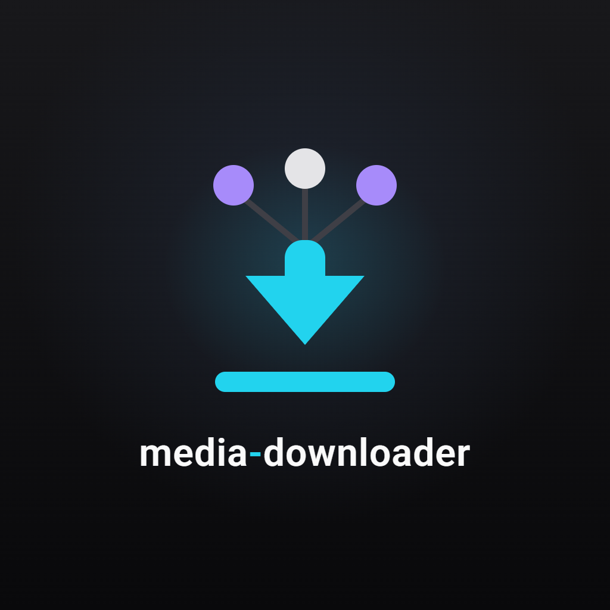
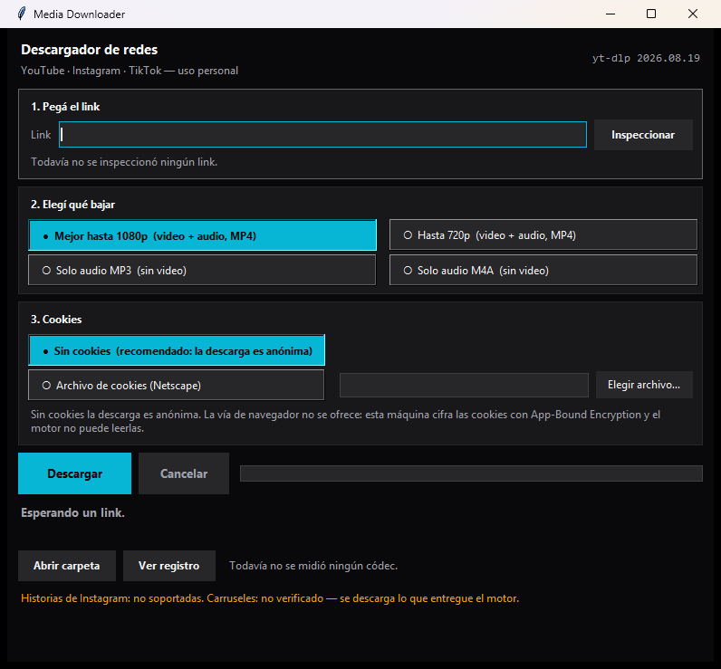

# Media Downloader

<p align="center"></p>

Aplicación de escritorio (Windows, tkinter) para descargar video y audio de **YouTube, Instagram y
TikTok** para **uso personal**. Nació porque Drift (el editor de video) limita la cantidad de
descargas: esta app corre en tu máquina, sin límite de descargas y **sin costo**.

<p align="center"></p>

- **Motor:** binario propio `bin\yt-dlp.exe` (2026.08.19) + `ffmpeg` para medir y recodificar.
- **Interfaz:** `descargador.bat` → ventana con pasos numerados: pegar link → elegir calidad → Descargar.
- **Estado de la suite:** 155 tests (sin red) + 4 tests de deriva (con red), todos en verde al
  2026-09-30.

---

## Instalación y uso

**Requisito único:** Python con `tkinter` instalado (el `.bat` lo detecta solo: prueba `import
tkinter` en cada intérprete del PATH antes de arrancar; eso evita el `python.exe` sin tkinter).

1. Doble clic a **`descargador.bat`**. No hay pasos de instalación: las dependencias de runtime son
   cero (todo vive en `bin\`).
2. Pegá el link. Podés **Inspeccionar** (identifica plataforma, título y duración sin descargar) o ir
   directo a **Descargar**.
3. Elegí calidad: *Mejor hasta 1080p* (default), *Hasta 720p*, *Solo audio MP3* o *Solo audio M4A*.
4. Los archivos quedan en **`downloads\`** (configurable). "Abrir carpeta" los muestra.

### Timeout y Cancelar

- **Cancelar** aborta la descarga en curso matando el **árbol** de procesos (yt-dlp **y** el ffmpeg
  del merge) y la app vuelve a estar disponible. Nunca se reporta éxito con un archivo incompleto.
- **Timeout de reloj:** si una descarga queda sin respuesta, se corta sola a los
  `timeout_segundos` (default **1800 s = 30 min**). El mensaje de error te dice cómo subir ese
  número. Se cambia en `config.json`.

### Política de residuos (qué se borra y qué no)

- El original **HEVC** de TikTok **se conserva por defecto** junto al `_h264.mp4` recodificado (es la
  copia de máxima calidad; la app te lo nombra para que lo borres a mano si querés).
- Con `limpiar_original_tras_recodificar: true` el original se borra **sólo si** el reemplazo
  `_h264.mp4` existe, pesa > 0 y `ffprobe` confirma `h264`. Si la recodificación falló, el original
  **permanece**.
- Los `.part` de una cancelación se conservan (son reanudables) a menos que pongas
  `limpiar_part_al_cancelar: true`.

`config.json` relevante: `timeout_segundos: 1800` · `limpiar_original_tras_recodificar: false` ·
`limpiar_part_al_cancelar: true` · `output_dir: "downloads"` · `player_client: "web_embedded"`.

---

## Uso personal y TyC (leé esto)

**Esta herramienta es para uso personal: descargar contenido propio o contenido que tenés permiso de
guardar (1–3 descargas por día como máximo).** Las condiciones de servicio (TyC) de YouTube,
Instagram y TikTok **prohíben en general descargar sin autorización**, y eso no es algo que este
proyecto pueda verificar por vos: **R6 (TyC) queda declarado NO VERIFICABLE.** No se redistribuye
nada, no hay descargas masivas, no hay proxies ni rotación de IP. La responsabilidad del uso es
tuya: descargá sólo lo que puedas guardar legítimamente.

Por la misma razón, **no se usan cookies de tu navegador**: la descarga es anónima y tu sesión (y tu
cuenta) no participa. Con este perfil de uso, hoy el riesgo de suspensión de cuenta es cero.

---

## Estado por plataforma (medido, no prometido)

| Plataforma | Estado | Video + audio | Procesamiento |
|---|---|---|---|
| **YouTube** | ✅ funciona | h264 + aac (se fuerza `player_client=web_embedded`) | **Nativo**: sin recodificar |
| **Instagram** | ✅ funciona (reels/posts) | vp9 + aac | **Nativo**: sin recodificar |
| **TikTok** | ✅ funciona, **puede fallar por post** | h265 (HEVC) + aac | **Recodificado a h264** con ffmpeg |

- La recodificación de TikTok tarda **≈ 2,7 s por minuto de video** (medido en suite con preset
  `veryfast`: 0,93 s para 20 s de video). No hay que comprar ni instalar el códec HEVC: recodificar
  lo evita.
- **TikTok puede fallar post por post** (posts antiguos dan "IP blocked" en el error del post): no es
  un bloqueo global de tu IP. El error literal se muestra, nunca se disfraza de éxito.
- **Historias de Instagram: no soportadas.** **Carruseles: no verificado** (se entrega lo que el
  motor dé). Ambas limitaciones están declaradas en la propia ventana de la app.
- Después de cada descarga se mide el archivo con `ffprobe`: si el video vino sin audio, la app lo
  avisa en ámbar ("SIN audio") en vez de reportar éxito silencioso.

---

## Cookies: por qué no se usan las del navegador (R8)

Las cookies de Chrome/Edge/Brave 154+ viajan cifradas con **App-Bound Encryption (v20)**: yt-dlp
**no puede leerlas** y falla en duro si se lo intenta. Medido en esta máquina: 100 % de las cookies
de Instagram en Chrome son v20. Por eso la opción de navegador está **retirada del MVP** y la GUI no
la ofrece.

El test `--cookies-from-browser chrome` es la **centinela de R8**: mientras devuelva `exit 1`, el
navegador sigue cifrando. Si un día devuelve `exit 0`, las cookies del navegador vuelven a ser
viables y se puede reabrir esa decisión.

**Vía activable hoy a futuro (opcional, desactivada por defecto):** exportar cookies a un **archivo
formato Netscape** (con una extensión de navegador o a mano) y pasarlo en la sección "Cookies" de la
app o con `--cookies <archivo>`. Esa vía no depende de App-Bound Encryption.

---

## Chequeo de deriva (por qué las plataformas pueden "dejarear")

yt-dlp pelea contra cambios de las plataformas; lo que hoy funciona puede romperse mañana. Para
detectarlo sin descargar nada:

```
uv run pytest -m deriva
```

Tarda ~40 s y ejecuta 4 tests contra los servicios reales (por eso están **fuera** de la suite por
defecto, que no toca la red). Interpretación:

| Resultado | Significado |
|---|---|
| `4 passed` | Las tres plataformas responden igual que el 2026-09-29 y la centinela de R8 sigue en `exit 1`. Todo normal. |
| Falla YouTube | Cambió el `player_client` o el formato: revisar la versión de yt-dlp (R1). |
| Falla Instagram | Cambió el formato o apareció login obligatorio (R2). |
| Falla TikTok | Probar otra URL: si es "IP blocked" puede ser el post (no global) (R3). |
| Falla **solo** el centinela R8 | `--cookies-from-browser chrome` pasó a `exit 0`: App-Bound Encryption ya no bloquea; las cookies del navegador vuelven a ser viables. |

Equivalente manual (líneas del §7.2 del plan v2):

```bat
bin\yt-dlp.exe --simulate --no-playlist --extractor-args "youtube:player_client=web_embedded" -f "bv*[vcodec^=avc1][height<=720]+ba" <URL_YT>   :: exit 0 y acodec != none
bin\yt-dlp.exe --simulate --no-playlist -f "bv*[height<=720]+ba/b" <URL_IG_REEL>                                                                  :: exit 0 (hoy vp9+aac)
bin\yt-dlp.exe --simulate --no-playlist -f "bv*[height<=720]+ba/b" <URL_TIKTOK>                                                                    :: hoy exit 0 en URL fresca; exit 1 "IP blocked" = post viejo
bin\yt-dlp.exe --simulate --cookies-from-browser chrome <URL_YT>                                                                                    :: HOY exit 1 por v20 (R8). Si pasa a exit 0 → R8 desapareció
```

---

## Limitaciones declaradas

- **Historias de Instagram: no soportadas** (decisión de diseño, D8).
- **Carruseles de Instagram: no verificado** — se descarga lo que el motor entregue.
- **Compatibilidad con Drift (R9): pendiente de verificación del usuario.** La política de códecs fue elegida por el
  código de Drift (acepta H.264 y VP9; no HEVC), pero falta la aceptación real: importar en Drift un
  MP4 de Instagram (vp9) y uno de TikTok (h264 recodificado). Si el VP9 no importa, el cambio es una
  línea (`codec_policy.instagram = "h264"`).
- Los fallos de red muestran el **error literal** del motor: el detalle completo queda en
  `descargador.log` (y en el tooltip del estado).

## Costos

**0.** yt-dlp (Unlicense), gallery-dl (GPL-2.0-only) y ffmpeg (GPL) son gratis; no hay proxies, no
se compra el códec HEVC (se recodifica con `libx264`), no hay servicios pagos. Este proyecto no
comercializa ni redistribuye nada.
